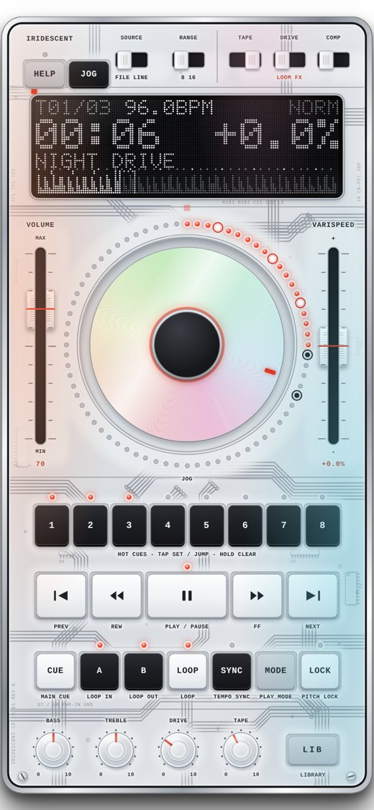
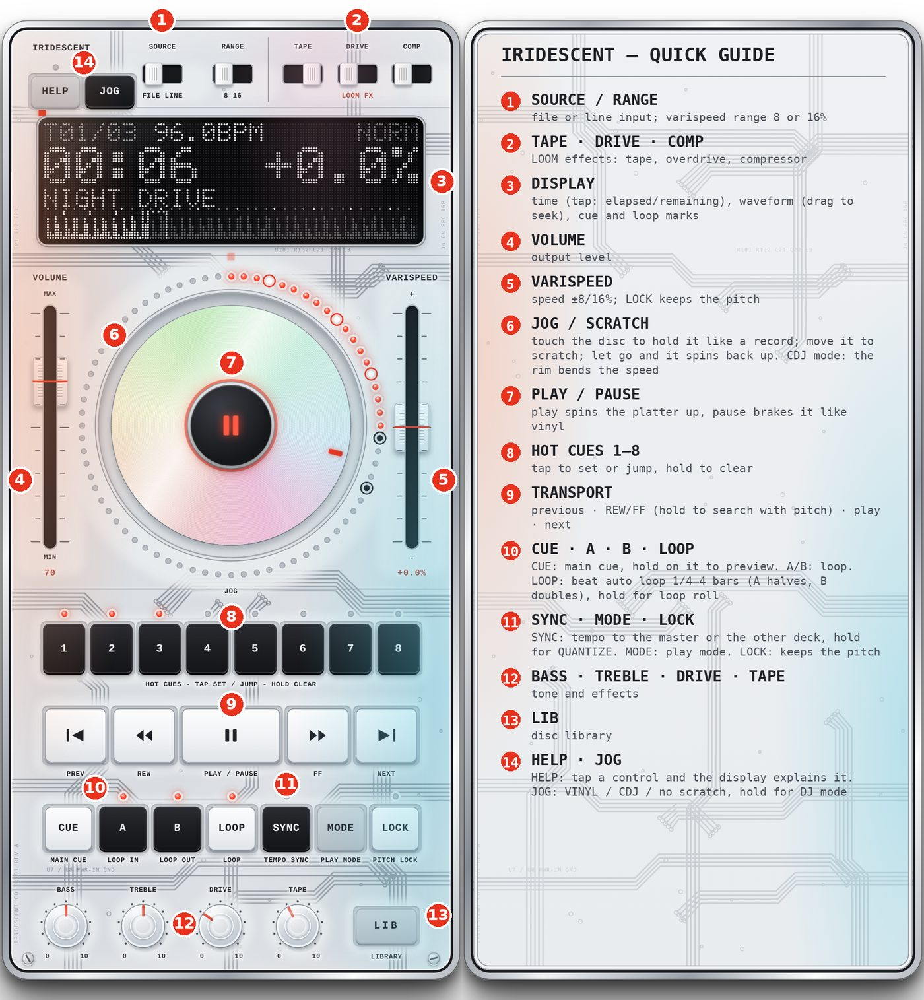
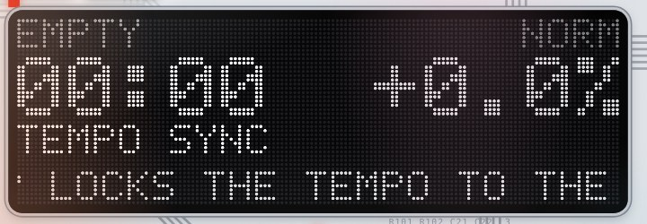
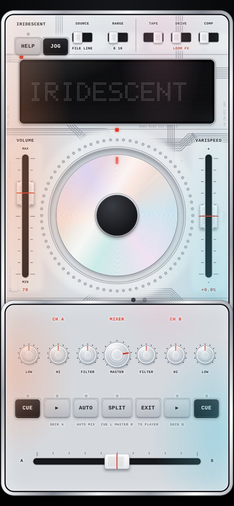
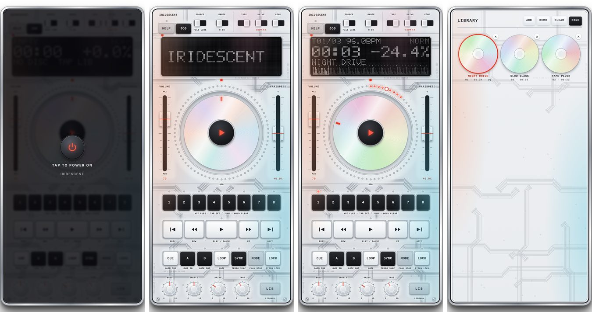
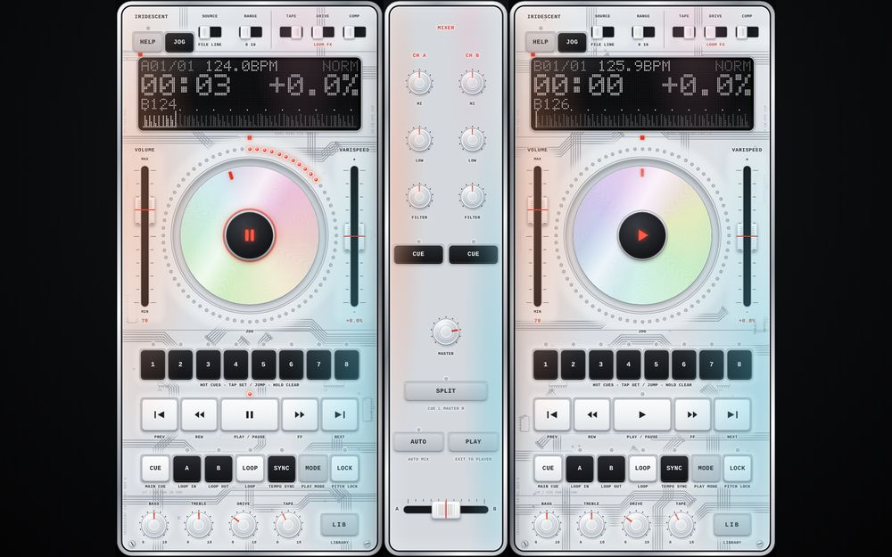

# IRIDESCENT

**An analog-digital CD player for the phone, with a DJ console for tablet and desktop.** Load your own audio files, spin them on a jog disc, scratch, drop hot cues, loop, sync two decks and warm everything up with tape, drive and compression. One `index.html`, no build step, no dependencies.

IRIDESCENT belongs to a small family of skeuomorphic, single-file instruments built around one look: frosted plastic over a visible PCB, a dot-matrix display, white ringed knobs and a single red accent.

## The family

| Project | What it is |
| --- | --- |
| **ZIIION** | The pocket bass-line machine. It defines the visual language: panel, knobs, switches, dot-matrix display. |
| **LOOM** | A set of guitar-effect pedals as a PWA. It defines the sound: tape, drive and compression stages. |
| **IRIDESCENT** | The CD player. ZIIION's face, LOOM's effects, plus transport built for a disc. |

IRIDESCENT reuses the ZIIION design system (knobs, buttons, switches, LEDs, PCB traces, 5x7 dot-matrix font) and carries simplified versions of the LOOM TAPE, DRIVE and COMP stages. Sibling of the cassette player TAPE-4.

## Quick guide

Russian version: [screens/guide-ru.jpg](screens/guide-ru.jpg). In the app, the HELP key does the same on the display itself:

DJ mode (hold JOG) on a phone: the mixer opens over the control buttons.

DJ mode on a tablet or a desktop is one console: two decks with a vertical mixer strip between them.

Keyboard (DJ mode): `Q W E R` deck A play / cue / sync / loop, `U I O P` the same for deck B, `,` and `.` move the crossfader, `\` toggles AUTO MIX. The mouse wheel over the disc scrubs or bends.

## Features

- **PLAY / DJ** – PLAY (default) is the single player, the same on every screen. Hold JOG to switch to DJ. On a phone it is a light DJ mode, in portrait only: two decks A/B and a mixer. Swipe left/right over the JOG area (free space or the display, not the disc itself, which scratches) to switch deck; two dots next to the JOG label show the active deck (red ring = playing). Swipe sideways in the control-button zone (hot cues, transport, function row): the whole lower half of the deck (including the FX knobs and LIB) slides away and the mixer takes its place, following your finger; swipe it back to the right (or press EXIT) to close, a vertical swipe works too (with a mouse: drag; on a trackpad: two-finger sideways swipe); The mixer has crossfader, LOW / HI, morphing FILTER, MASTER, CUE pre-listen with SPLIT and **AUTO MIX**: near the end of a disc the other deck takes the next one, syncs the tempo, starts on the beat and the crossfader rides over. SYNC follows the other deck's tempo. The disc hub is just a spindle; PLAY lives in the transport row. On a tablet or a desktop DJ is a wide console with both decks and the mixer on screen at once.
- **Disc physics** – platter spin-up and brake, flick inertia, REW/FF as tape-style search with pitch, auto loops (1/4 to 4 bars), loop roll with slip, CDJ cue, JOG modes VINYL / CDJ (rim bends the speed).
- **Tempo** – BPM and beat grid are detected on load (cached per file); beat ticks on the display, the red LED pulses on the beat. **SYNC** locks the deck to the master tempo via varispeed (8/16 %, half/double aware), hold it for **QUANTIZE** (cues and loops snap to the beat). Tap the BPM on the display to fix half/double time.
- **Scratch**: touch the disc and it stops like a record under your finger; move it back and forth to scratch, forwards and backwards, with vinyl friction noise and the full effect chain. Release and the disc plays on. (Experimental: `index.html#gapless` hands the sound back without the ~0.4 s hole iOS leaves after a seek; it is off by default until it is verified on a real iPhone.) The SCR key turns it off; then the jog only scrubs while paused and nudges the speed while playing.
- **8 hot cues** per track: tap to set or jump, hold to clear. Stored per file.
- **A-B loop**, **MAIN CUE**, **PREV / REW / PLAY / FF / NEXT**, play modes.
- **Weighted knobs**: values glide on a damped spring, a quick flick keeps turning for a moment like a DJ-deck encoder, double tap glides back to default, and the audio parameters morph instead of jumping.
- **Varispeed** fader, range 8 or 16 percent, with **LOCK** to keep pitch.
- **LOOM FX**: TAPE (wow, flutter, hiss, saturation), DRIVE (tanh waveshaper, 2x oversampling), COMP, plus BASS and TREBLE.
- **LINE IN** from the device input, with echo cancellation and noise suppression off.
- **Phone in landscape**: no separate layout by design; the player keeps its portrait panel and shows a small rotate hint. The installed app (home-screen icon) is locked to portrait.
- **Waveform** on the display and a 72-LED progress ring.
- **Resume**: remembers the position of each file; load it again and it picks up where you left it.
- **Disc cover**: every disc gets its own iridescent colors, derived from the file.
- **Disc change animation**: the old disc lifts out, the new one drops onto the spindle.
- **Library**: a shelf of big iridescent discs, each with its title and length; the playing disc has a red ring. Tap a disc to load it, tap the cross to remove it. New discs drop in one by one.
- **HELP mode**: press HELP, then tap any control; the dot-matrix display names it and scrolls what it does. Nothing is triggered while help is on.
- Media Session controls on the lock screen, Wake Lock, silent-switch workaround on iOS.
- Built-in demo disc (three synthesized tracks), so it plays with nothing loaded.

## Use

Open `index.html` in a browser, tap to power on, press **LIB** and add audio files (mp3, m4a, wav, flac, ogg and others the browser can decode). On iPhone, add it to the home screen: it opens full-screen as an app (`manifest.webmanifest`) and stays in portrait.

For offline use and installation, host the folder (for example on GitHub Pages) so `manifest.webmanifest` and `sw.js` are served. Opened as a plain file it still works, without the offline cache.

## Icon

The home-screen icon is a simple iridescent disc with a white hub and a red accent square on a frosted gradient. It is drawn at runtime by the page; PNG exports are in `icons/` (512, 180, 32 px), and the manifest uses them.

## Notes

- Files stay on your device; nothing is uploaded.
- Waveform peaks are computed for files up to 110 MB.
- Layout: `index.html`, `manifest.webmanifest`, `sw.js`, `icons/`, `screens/` (all pictures used in this README).
- Tested in headless Chromium. Behaviour on iOS Safari (pitch lock, lock screen, silent switch, two decks sharing one audio context in DJ mode) should be confirmed on a real device.

## Roadmap

- Share one FX engine with LOOM instead of keeping two copies.
- Album mode: a playlist shown as one disc.

## License

MIT, copyright Kirill Kinderhart. See `LICENSE`.
