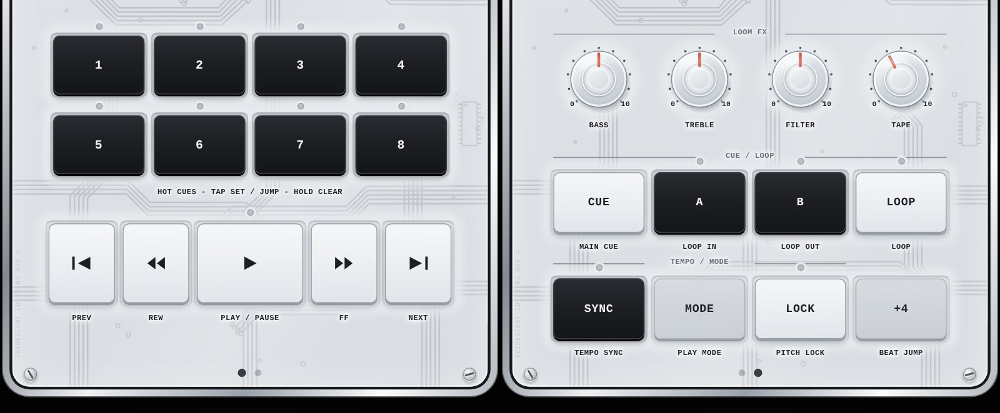

# IRIDESCENT

**An analog-digital CD player for the phone, tablet and desktop.** Load your own audio files, spin them on a jog disc, scratch, drop hot cues, loop, match the tempo and warm everything up with tape, a filter and compression. One `index.html`, no build step, no dependencies.

**[Open the live app](https://shoogaze.github.io/iridescent-player-/)** — on iPhone, open it in Safari and use Share → Add to Home Screen.

IRIDESCENT belongs to a small family of skeuomorphic, single-file instruments built around one look: frosted plastic over a visible PCB, a dot-matrix display, white ringed knobs and a single red accent.

## The family

| Project | What it is |
| --- | --- |
| [**ZIIION**](https://github.com/SHOOGAZE/ziiion-synth) | The pocket bass-line machine. It defines the visual language: panel, knobs, switches, dot-matrix display. |
| [**LOOM**](https://shoogaze.github.io/loom-pedalboard/) | A set of guitar-effect pedals as a PWA. It defines the sound: tape, drive and compression stages. |
| **IRIDESCENT** | The CD player. ZIIION's face, LOOM's effects, plus transport built for a disc. |

IRIDESCENT reuses the ZIIION design system (knobs, buttons, switches, LEDs, PCB traces, 5x7 dot-matrix font) and carries simplified versions of the LOOM TAPE and COMP stages plus a one-knob FILTER. Sibling of the cassette player TAPE-4.

## Screens

The top of the deck holds the display with the LIB button, the jog disc with its progress ring and the VARISPEED fader. The lower half is a carousel of big-button pages (swipe sideways, two dots show where you are): pads and transport, functions and FX.

A disc with its printed label (banner layout, edited in LIBRARY → LABEL):

In the app, press HELP and tap any control: the dot-matrix display names it and scrolls what it does.

Keyboard: `Space` play / pause, `←` `→` seek 5 s, `N` / `P` next / previous. The mouse wheel over the disc scrubs or bends.

## Features

- **The disc**: it turns at a CD's speed (fast near the hub, slowing toward the rim as the track plays), translucent so the board shows through. Hold JOG to flip it between COLOR (a hue per disc) and WHITE. Grab it with a finger to hold it still, move it both ways to scratch, let go and it spins back up.
- **Disc label**: every disc gets a printed face generated from the file (title and artist from the file name, real length, format and size) in one of eight layouts (classic, banner, technical, dotted, ruled card, corner block, stripe, handwritten mixtape) or left blank with just a fine rim line. Open LIBRARY → LABEL to edit two lines and a handwritten note, pick a layout (AUTO picks one per disc) or reset. Labels are stored on the device. No brand names or logos.
- **Beat jump**: on page 2 the BEAT JUMP button jumps the playhead by the shown number of beats (+1, +4, +8, +16 or back −1 … −16). Hold it to change the step. Needs a detected BPM.
- **Disc physics** – platter spin-up and brake, flick inertia, REW/FF as tape-style search with pitch, auto loops (1/4 to 4 bars), loop roll with slip, CDJ cue, JOG modes VINYL / CDJ (rim bends the speed).
- **Tempo** – BPM and beat grid are detected on load (cached per file); beat ticks on the display. **SYNC** locks the deck to the master tempo via varispeed (8/16 %, half/double aware), hold it for **QUANTIZE** (cues and loops snap to the beat). Tap the BPM on the display to fix half/double time.
- **CD behaviour**: PLAY spins the disc up first (about half a second), then the sound starts at full speed; PAUSE cuts the sound at once with no pitch fall (that is for tapes) while the disc spins down. Scratching keeps its vinyl feel.
- **Buffer engine**: the disc is decoded and played from memory, so VARISPEED glides smoothly and play/pause has no dropout (like HISS). LOCK (pitch lock) uses its own WSOLA time-stretch in an AudioWorklet, so tempo changes keep the pitch. With the screen locked it keeps playing from the buffer (a timer drives the engine and the next track starts on its own), the same way HISS does. Add `#nobuf` to the URL to switch it off.
- **Scratch**: touch the disc and it stops like a record under your finger; move it back and forth to scratch, forwards and backwards, with vinyl friction noise and the full effect chain. Release and the disc plays on. (Experimental: `index.html#gapless` hands the sound back without the ~0.4 s hole iOS leaves after a seek; it is off by default until it is verified on a real iPhone.) The SCR key turns it off; then the jog only scrubs while paused and nudges the speed while playing.
- **8 hot cues** per track: tap to set or jump, hold to clear. Stored per file.
- **A-B loop**, **MAIN CUE**, **PREV / REW / PLAY / FF / NEXT**, play modes.
- **Weighted knobs**: values glide on a damped spring, a quick flick keeps turning for a moment like a DJ-deck encoder, double tap glides back to default, and the audio parameters morph instead of jumping.
- **Varispeed** fader, range 8 or 16 percent, with **LOCK** to keep pitch. Output level is fixed (there is no volume fader); the phone's own volume sets loudness.
- **Level meter**: two L/R LED columns on the display, read after the limiter, with red clip segments; useful with TAPE and COMP.
- **LOOM FX**: TAPE (wow, flutter, hiss, saturation), FILTER (one knob: low-pass to the left, high-pass to the right, open in the middle), COMP, plus BASS and TREBLE.
- **LINE IN** from the device input, with echo cancellation and noise suppression off.
- **Phone in landscape**: no separate layout by design; the player keeps its portrait panel and shows a small rotate hint. The installed app (home-screen icon) is locked to portrait.
- **Waveform** on the display and a thin progress ring around the disc that also shows your cue points and the loop.
- **Resume**: remembers the position of each file; load it again and it picks up where you left it.
- **Disc cover**: every disc gets its own iridescent colors, derived from the file.
- **Disc change animation**: the old disc lifts out, the new one drops onto the spindle.
- **Library** (the LIB button next to the display): your files are stored in the browser (IndexedDB) and survive a reload. A shelf of big iridescent discs, each with its printed label and length; the `#` button opens a number pad to jump to a track by its number; the playing disc has a red ring. Tap a disc to load it, tap the cross to remove it. New discs drop in one by one.
- **HELP mode**: press HELP, then tap any control; the dot-matrix display names it and scrolls what it does. Nothing is triggered while help is on. Hints come in English and Russian (the display has a Cyrillic dot-matrix font): hold HELP to switch; the language follows the browser by default.
- Media Session controls on the lock screen, Wake Lock, silent-switch workaround on iOS.
- Built-in demo disc (three synthesized tracks), so it plays with nothing loaded.

## Use

Open `index.html` in a browser, tap to power on, press **LIB** and add audio files (mp3, m4a, wav, flac, ogg and others the browser can decode). On iPhone, add it to the home screen: it opens full-screen as an app (`manifest.webmanifest`) and stays in portrait.

For offline use and installation, host the folder (for example on GitHub Pages) so `manifest.webmanifest` and `sw.js` are served. Opened as a plain file it still works, without the offline cache.

## Icon

The home-screen icon is an iridescent disc in a bezel with a white hub and a red accent square, on a frosted board with thin PCB traces and ring vias, in the ZIIION style. It is drawn at runtime by the page; PNG exports are in `icons/` (512, 180, 32 px), and the manifest uses them.

## Notes

- Files stay on your device; nothing is uploaded.
- Waveform peaks are computed for files up to 110 MB.
- Layout: `index.html`, `manifest.webmanifest`, `sw.js`, `icons/`, `screens/` (all pictures used in this README).
- Tested in headless Chromium. Behaviour on iOS Safari (pitch lock, lock screen, silent switch) should be confirmed on a real device.

## Roadmap

- Share one FX engine with LOOM instead of keeping two copies.
- Album mode: a playlist shown as one disc.

## License

MIT, copyright Kirill Kinderhart. See `LICENSE`.
