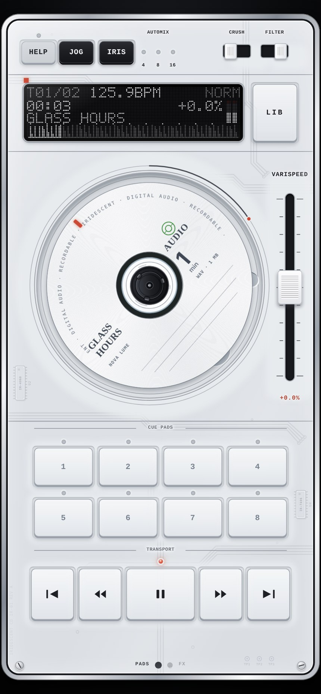
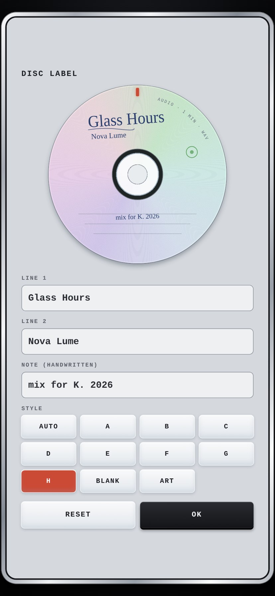
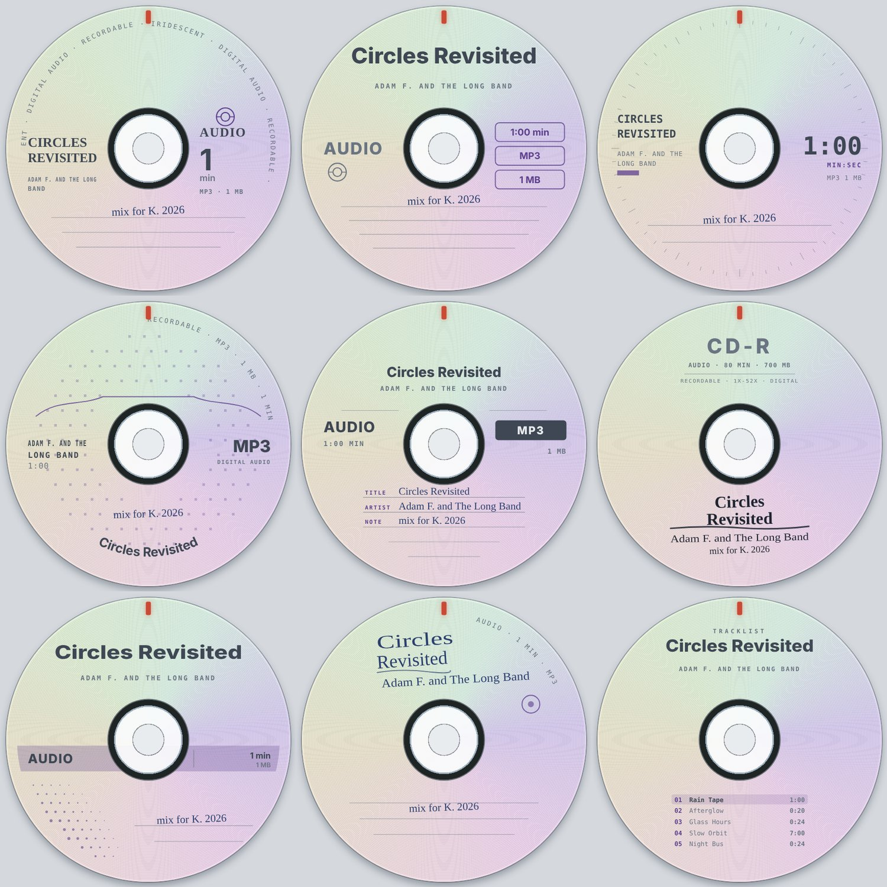
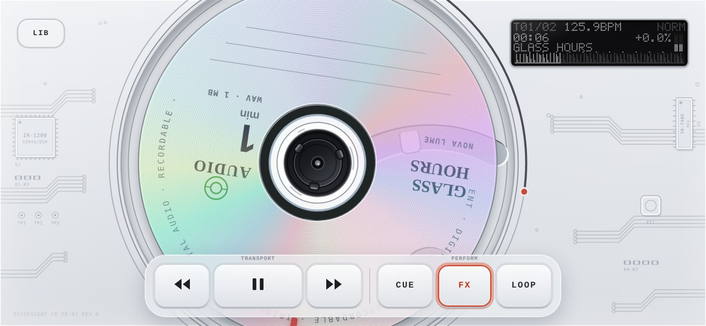

# IRIDESCENT

**[▶ Open the app](https://shoogaze.github.io/iridescent-player-/)**  ·  works in the browser, installs to the Home Screen

[ZIIION](https://github.com/SHOOGAZE/ziiion-synth) &nbsp;·&nbsp; **IRIDESCENT**

An analog-digital CD player in a single file. Load your own audio, spin it on a jog disc, scratch, drop hot cues, loop, match the tempo and crunch it with a bit-crusher and a filter. The look is frosted plastic over a visible PCB, a dot-matrix display, white ringed knobs and one red accent.

It plays your files and nothing leaves the device: no account, no upload, no build step, no dependencies.

## Features

- **The disc**: it turns at a CD's speed, fast near the hub and slower toward the rim. Grab it to hold it still, move it both ways to scratch, let go and it spins back up. Hold JOG to flip between COLOR (a hue per disc) and a solid WHITE disc
- **Printed labels**: every disc gets a face generated from its file (title, artist, length, format) in one of eight layouts, a numbered tracklist, ART from the cover embedded in the file, or blank. Edit two lines and a note in LIBRARY → LABEL
- **Drive**: PLAY spins the disc up first, then the sound starts at full speed. PAUSE cuts the sound at once. Clear discs show the moulded deck underneath with a slider that travels from the hub to the rim
- **Tempo**: BPM and beat grid are detected on load. **SYNC** locks the deck to a master tempo through varispeed (±16 %), **QUANTIZE** snaps cues and loops to the beat, tap tempo fixes a wrong BPM
- **Automix**: the next disc is decoded ahead and fades in on the beat grid, 4, 8 or 16 s
- **Cues and loops**: 8 hot cues per track, A-B loop, auto loops from 1/4 to 4 bars, loop roll, beat jump
- **Varispeed** with a weighted fader and **LOCK** to keep the pitch (own time-stretch, so tempo changes stay in tune)
- **FX**: CRUSH (bit depth and sample rate) and FILTER (one knob: low-pass left, high-pass right). A limiter guards the output
- **Sounds**: soft key clicks, a drive that spins up, a quiet hum, a searching whirr on FF / REW, a case sound for the library. On by default, hold LIB to switch them off
- **Library**: your files stay in the browser as a shelf of discs; a number pad jumps to a track
- **Landscape**: a viewing mode with a big disc and a frosted bar that fades away after a few seconds
- **HELP**: press HELP, tap any control and the display names it and scrolls what it does (English and Russian)
- **Lock screen**: keeps playing with the screen locked, with lock-screen controls
- **Installable**: add to the Home Screen and it works offline (PWA)

Keyboard: `Space` play / pause, `←` `→` seek 5 s, `N` / `P` next / previous.

## Screenshots

  
  
  

Player &nbsp;·&nbsp; Pages: pads, transport, functions, FX &nbsp;·&nbsp; White disc

### Labels

  
  

A disc with its label &nbsp;·&nbsp; Styles A–H and the tracklist

### Landscape

  

## The nano-tech family

Two single-file instruments in one design language: frosted plastic over a faint circuit board, a dot-matrix display, raised white controls and one muted red accent.

| App | What it is | Live |
|---|---|---|
| [ZIIION](https://github.com/SHOOGAZE/ziiion-synth) | A pocket acid bass-line synth and step sequencer; it defines the look | [open](https://shoogaze.github.io/ziiion-synth/) |
| **IRIDESCENT** (this one) | A CD player with a jog disc and tempo tools built for a disc | [open](https://shoogaze.github.io/iridescent-player-/) |

IRIDESCENT reuses the ZIIION design system (knobs, buttons, switches, LEDs, PCB traces, 5×7 dot-matrix font) and adds a disc, a transport and its own FX. The apps do not exchange data: each one works on its own.

## Run

Live build: https://shoogaze.github.io/iridescent-player-/

Open `index.html` in a browser, tap to power on, press **LIB** and add audio files (mp3, m4a, wav, flac, ogg and anything else the browser can decode). No build step. For GitHub Pages: Settings → Pages → deploy from branch `main`, root.

**Install on iPhone:** open the site in Safari → Share → Add to Home Screen. It then runs full-screen and offline. Keep `manifest.webmanifest`, `sw.js` and the `icons/` folder next to `index.html`.

Without hosting (a plain file) it still plays, only without the offline cache.

## Notes

- Files stay on your device. Waveform peaks are computed for files up to 110 MB.
- A built-in demo disc plays with nothing loaded.
- Tested in headless Chromium. Sound, pitch lock, the lock screen and the silent switch on iOS Safari still need confirming on a real phone.

## License

[MIT](LICENSE) © 2026 Kirill Kinderhart
