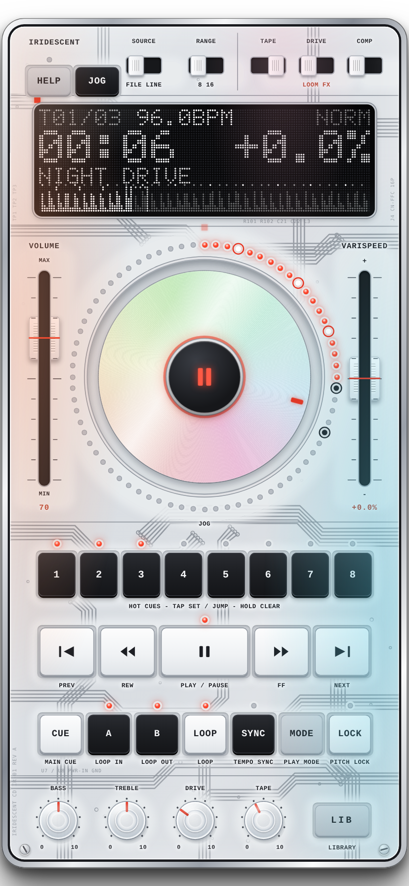
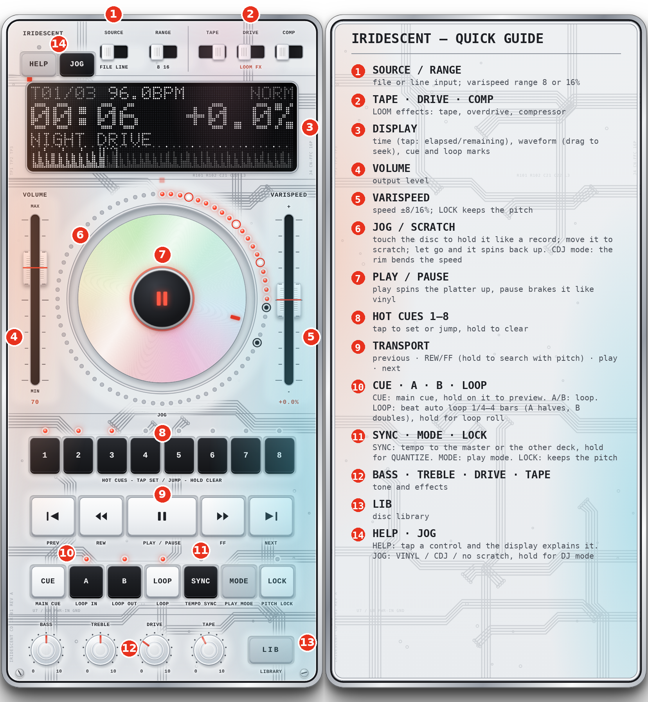
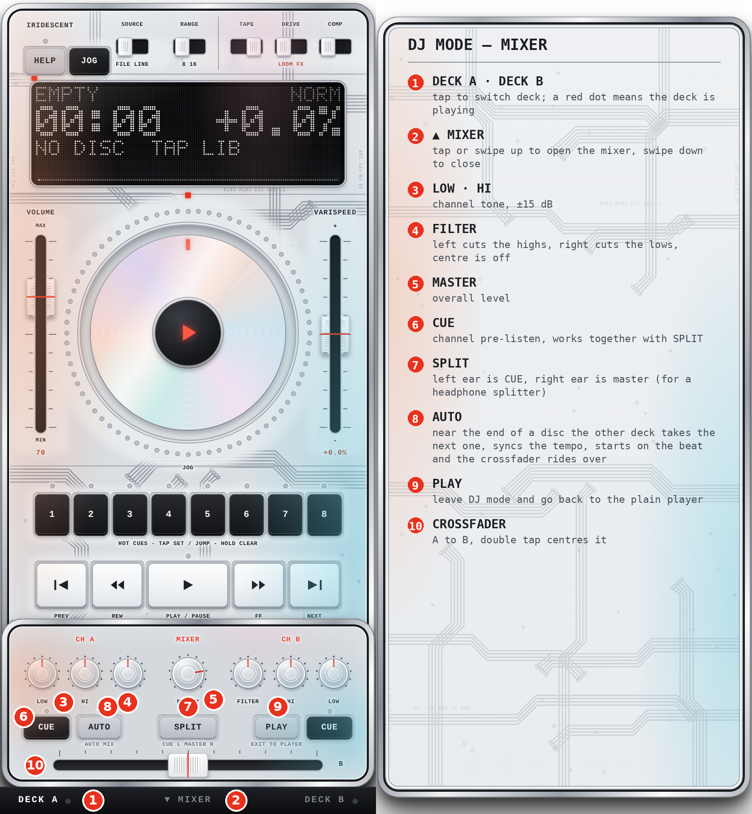
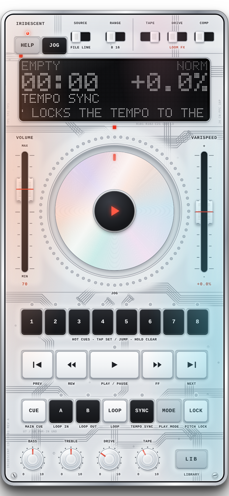
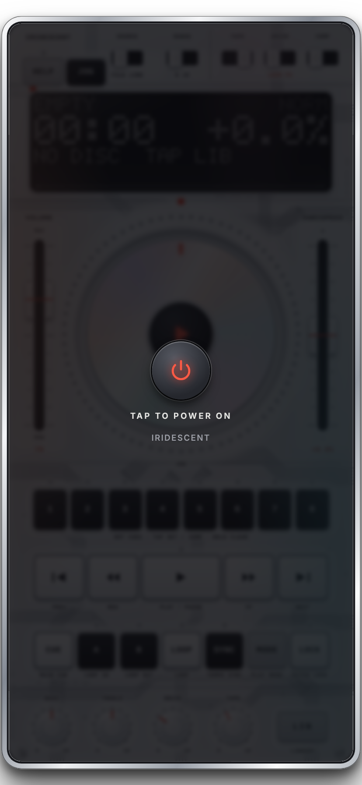
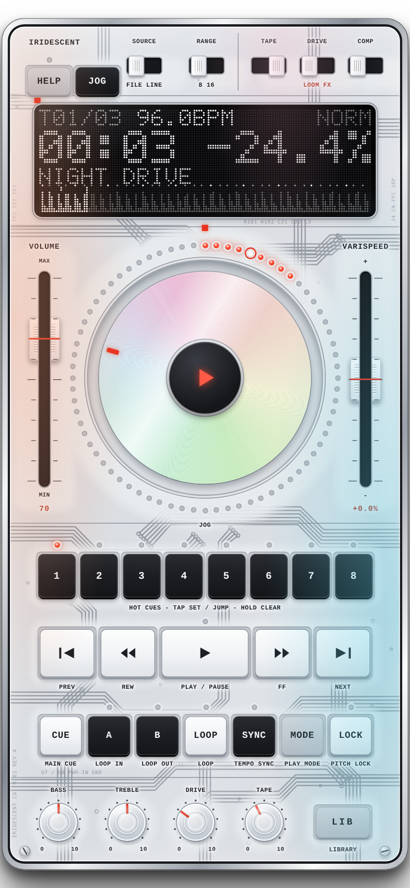
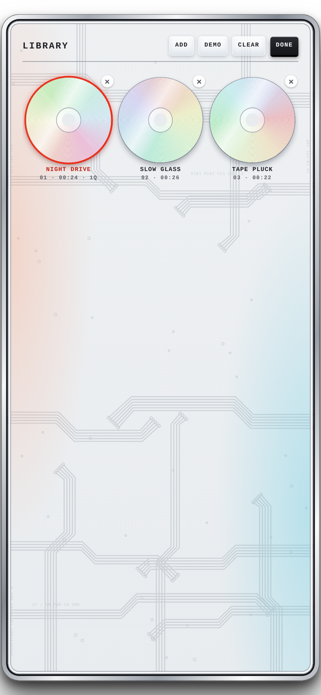

# IRIDESCENT

**An analog-digital CD player for the phone.** Load your own audio files, spin them on a jog disc, drop hot cues, loop, bend the speed, and warm everything up with tape, drive and compression. One `index.html`, no build step, no dependencies.

IRIDESCENT belongs to a small family of skeuomorphic, single-file instruments built around one look: frosted plastic over a visible PCB, a dot-matrix display, white ringed knobs and a single red accent.

## The family

| Project | What it is |
| --- | --- |
| **ZIIION** | The pocket bass-line machine. It defines the visual language: panel, knobs, switches, dot-matrix display. |
| **LOOM** | A set of guitar-effect pedals as a PWA. It defines the sound: tape, drive and compression stages. |
| **IRIDESCENT** | The CD player. ZIIION's face, LOOM's effects, plus transport built for a disc. |

IRIDESCENT reuses the ZIIION design system (knobs, buttons, switches, LEDs, PCB traces, 5x7 dot-matrix font) and carries simplified versions of the LOOM TAPE, DRIVE and COMP stages. Sibling of the cassette player TAPE-4.

## Quick guide

Russian version: [docs/guide-ru.png](docs/guide-ru.png).

DJ mode (hold JOG): 

Russian: [docs/guide-mixer-ru.png](docs/guide-mixer-ru.png). In the app, the HELP key does the same on the display itself.

| Power-on | Splash | Scratch | Library |
| --- | --- | --- | --- |
|  |  |  |  |

## Features

- **PLAY / DJ** – PLAY (default) is the single player. Hold JOG to switch to DJ: two decks A/B (tap the bar at the bottom or swipe), a mixer drawer pulled up from the bar (crossfader, LOW / HI, morphing FILTER, MASTER, CUE pre-listen with SPLIT) and **AUTO MIX**: near the end of a disc the other deck takes the next one, syncs the tempo, starts on the beat and the crossfader rides over. PLAY in the drawer goes back. SYNC follows the other deck's tempo.
- **Disc physics** – platter spin-up and brake, flick inertia, REW/FF as tape-style search with pitch, auto loops (1/4 to 4 bars), loop roll with slip, CDJ cue, JOG modes VINYL / CDJ (rim bends the speed).
- **Tempo** – BPM and beat grid are detected on load (cached per file); beat ticks on the display, the red LED pulses on the beat. **SYNC** locks the deck to the master tempo via varispeed (8/16 %, half/double aware), hold it for **QUANTIZE** (cues and loops snap to the beat). Tap the BPM on the display to fix half/double time.
- **Scratch**: touch the disc and it stops like a record under your finger; move it back and forth to scratch, forwards and backwards, with vinyl friction noise and the full effect chain. Release and the disc plays on. The SCR key turns it off; then the jog only scrubs while paused and nudges the speed while playing.
- **8 hot cues** per track: tap to set or jump, hold to clear. Stored per file.
- **A-B loop**, **MAIN CUE**, **PREV / REW / PLAY / FF / NEXT**, play modes.
- **Weighted knobs**: values glide on a damped spring, a quick flick keeps turning for a moment like a DJ-deck encoder, double tap glides back to default, and the audio parameters morph instead of jumping.
- **Varispeed** fader, range 8 or 16 percent, with **LOCK** to keep pitch.
- **LOOM FX**: TAPE (wow, flutter, hiss, saturation), DRIVE (tanh waveshaper, 2x oversampling), COMP, plus BASS and TREBLE.
- **LINE IN** from the device input, with echo cancellation and noise suppression off.
- **Waveform** on the display and a 72-LED progress ring.
- **Resume**: remembers the position of each file; load it again and it picks up where you left it.
- **Disc cover**: every disc gets its own iridescent colors, derived from the file.
- **Disc change animation**: the old disc lifts out, the new one drops onto the spindle.
- **Library**: a shelf of big iridescent discs, each with its title and length; the playing disc has a red ring. Tap a disc to load it, tap the cross to remove it. New discs drop in one by one.
- **HELP mode**: press HELP, then tap any control; the dot-matrix display names it and scrolls what it does. Nothing is triggered while help is on.
- Media Session controls on the lock screen, Wake Lock, silent-switch workaround on iOS.
- Built-in demo disc (three synthesized tracks), so it plays with nothing loaded.

## Use

Open `index.html` in a browser, tap to power on, press **LIB** and add audio files (mp3, m4a, wav, flac, ogg and others the browser can decode). On iPhone, add it to the home screen for full-screen mode.

For offline use, host the folder (for example on GitHub Pages) so `sw.js` can register. Opened as a plain file it still works, without the offline cache.

## Icon

The home-screen icon is a simple iridescent disc with a white hub and a red accent square on a frosted gradient. It is drawn at runtime by the page; PNG exports are in `icons/` (512, 180, 32 px).

## Notes

- Files stay on your device; nothing is uploaded.
- Waveform peaks are computed for files up to 110 MB.
- Tested in headless Chromium. Behaviour on iOS Safari (pitch lock, lock screen, silent switch) should be confirmed on a real device.

## Roadmap

- Share one FX engine with LOOM instead of keeping two copies.
- Album mode: a playlist shown as one disc.

## License

MIT, copyright Kirill Kinderhart. See `LICENSE`.
